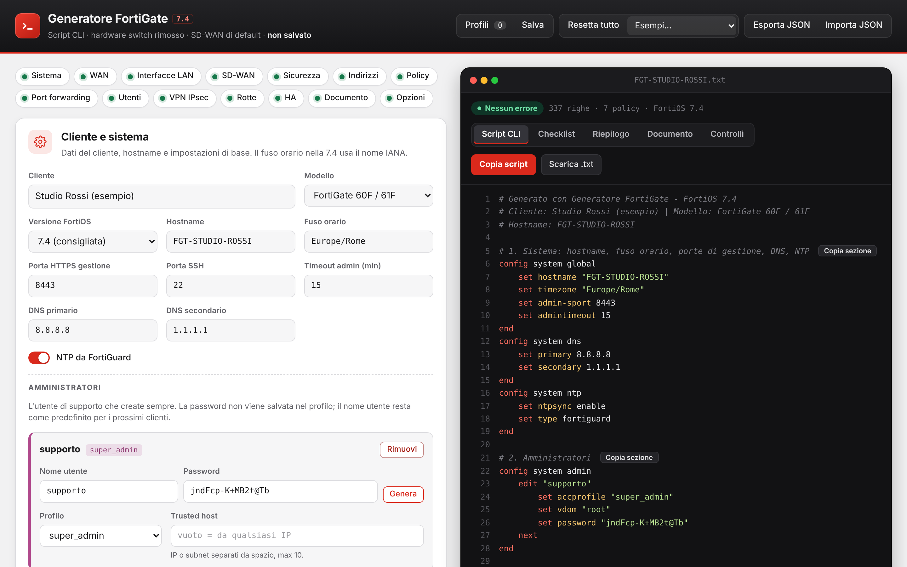
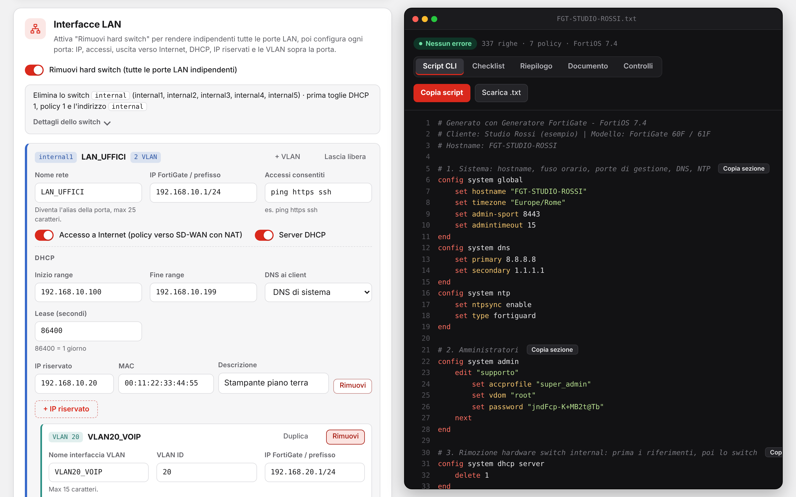
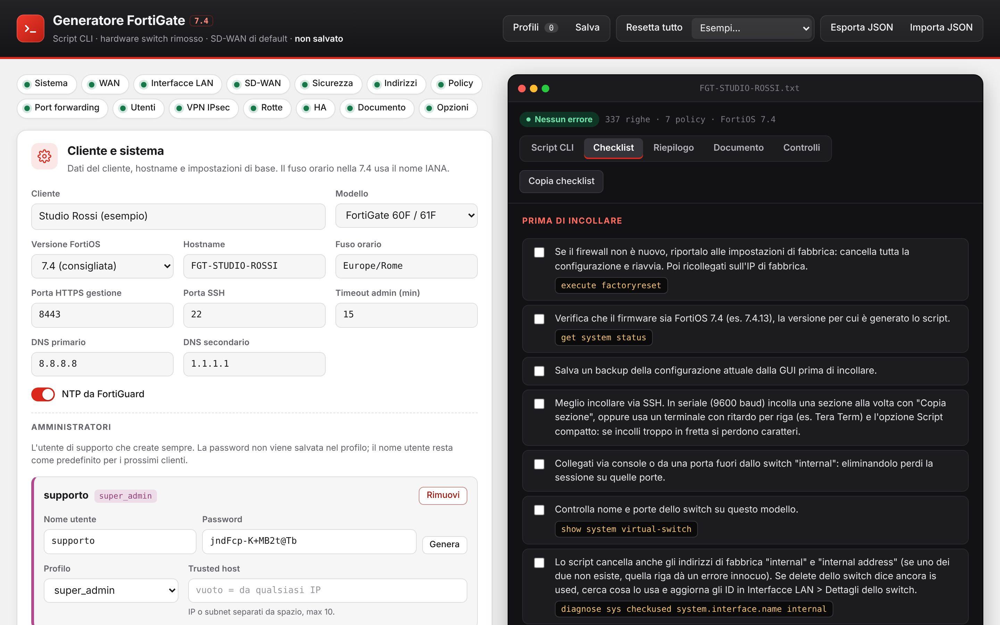
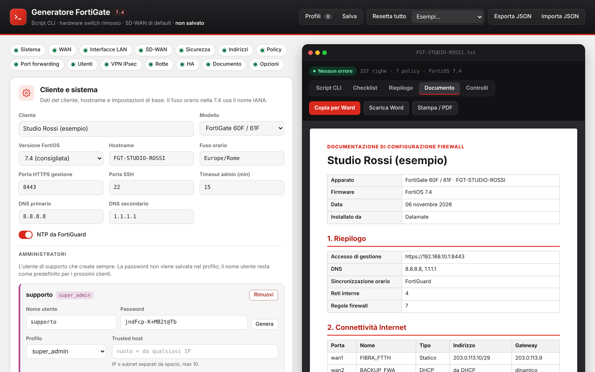

# Generatore FortiGate

Web app che trasforma un modulo compilato in uno **script CLI pronto da incollare** su un firewall FortiGate, con checklist di installazione e documento di consegna per il cliente.

**Demo:** https://andreamorici.github.io/generatore-fortigate/

## Perché l'ho creato

Lavoro come network systems administrator e installo firewall FortiGate per aziende clienti. Ogni installazione ripete gli stessi passi (rimuovere l'hardware switch, configurare SD-WAN, VLAN, DHCP, policy, VPN, utente di supporto) e scrivere la CLI a mano è lento e facile da sbagliare. Il generatore produce uno script coerente in pochi minuti e controlla gli errori prima che arrivino sull'apparato.

## Cosa fa

- **26 modelli FortiGate** (dal 30E al 1100E) con i nomi reali delle porte, presi dalla FortiOS Hardware Acceleration Guide
- **FortiOS 7.4, 7.2, 7.0, 6.4 e 6.2**: la sintassi cambia in base alla versione (es. `virtual-wan-link` in 6.2, `sdwan-zone` dalla 7.0)
- **Interfacce LAN**: rimozione dell'hardware switch di fabbrica, una rete per porta, VLAN, DHCP con IP riservati
- **SD-WAN** con performance SLA e failover, **rotte statiche**, **port forwarding**
- **Policy firewall** con profili di sicurezza, oggetti indirizzo e gruppi
- **VPN IPsec**: accesso remoto per FortiClient (IKEv1/IKEv2) e site-to-site
- **Utenti, gruppi e amministratori**, **alta affidabilità (HA)** con lo script per il secondo firewall
- **Controlli automatici**: subnet sovrapposte, porte inesistenti sul modello, range DHCP errati, nomi troppo lunghi, servizi scritti male
- **Checklist** prima e dopo l'installazione, con i comandi di verifica
- **Documento per il cliente** da copiare in Word o stampare in PDF, senza password
- **Profili cliente** salvati nel browser, con backup ed esportazione in JSON

| Interfacce LAN | Checklist | Documento per il cliente |
|---|---|---|
|  |  |  |

## Testato su apparato reale

Provato su un FortiGate 30E con FortiOS 6.2 via console seriale. Il test ha fatto emergere problemi reali, poi corretti nel generatore:

- un apostrofo nei commenti apriva una stringa nella CLI e bloccava tutto lo script
- lo switch di fabbrica non si eliminava perché referenziato da un oggetto indirizzo
- FortiOS distingue maiuscole e minuscole nei nomi dei servizi (`PING`, non `ping`)

## Come è fatto

- Un unico file HTML con JavaScript, senza dipendenze né backend
- I dati restano nel browser (localStorage); password e chiavi VPN non vengono mai salvate né esportate
- Sviluppato con l'aiuto di Claude (Anthropic) come assistente di programmazione

## Uso

Apri la demo, scegli modello e versione FortiOS, compila le sezioni e copia lo script. Rileggi sempre lo script prima di incollarlo e tieni a portata il cavo console.

---

### English summary

A single-file web app that turns a form into a ready-to-paste **FortiGate CLI script**, with an installation checklist and a client hand-over document. It supports 26 FortiGate models and FortiOS 6.2 to 7.4, and covers LAN interfaces and VLANs, SD-WAN, firewall policies, IPsec VPN, HA and static routes, with validation before anything reaches the device. It was tested on a real FortiGate 30E.

---

*Strumento indipendente, non affiliato né approvato da Fortinet. Fortinet, FortiGate, FortiOS e FortiClient sono marchi di Fortinet, Inc.*
